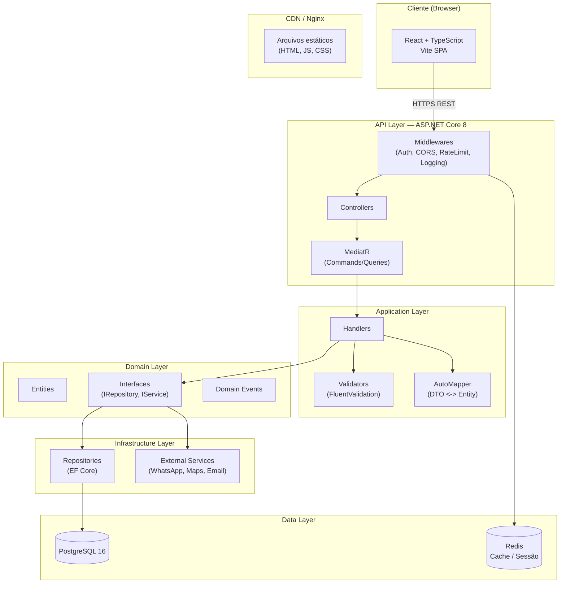
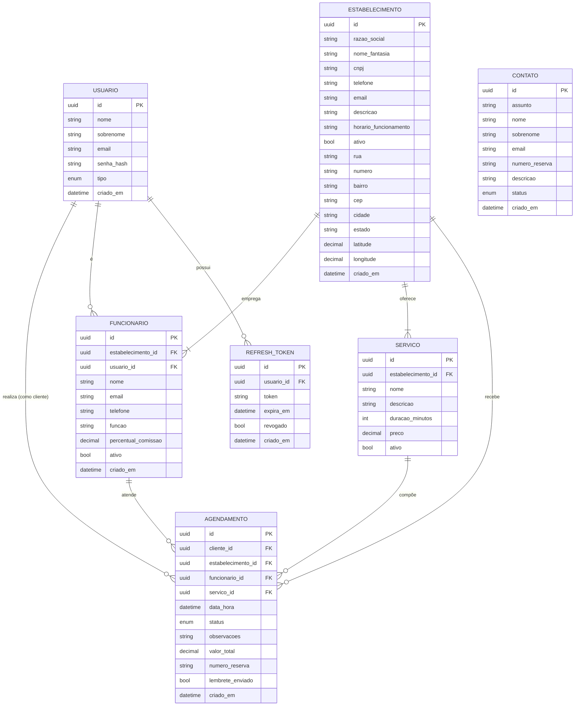
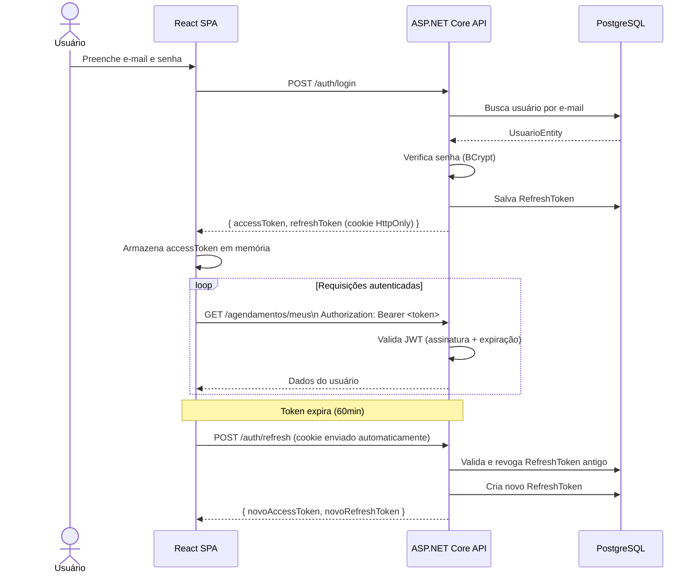

# Navalha & Corte — Documentação Técnica Completa

> **Projeto Integrador — UNIVESP**
> Plataforma web para busca, agendamento e gestão de serviços de barbearias e salões.

---

## Sumário

1. [Visão Geral do Produto](#1-visão-geral-do-produto)
2. [Requisitos Funcionais](#2-requisitos-funcionais)
3. [Requisitos Não Funcionais](#3-requisitos-não-funcionais)
4. [Interfaces do Front-end](#4-interfaces-do-front-end)
5. [Stack de Tecnologias](#5-stack-de-tecnologias)
6. [Arquitetura do Back-end (.NET)](#6-arquitetura-do-back-end-net)
7. [Modelo de Dados — Entidades](#7-modelo-de-dados--entidades)
8. [Rotas da API REST](#8-rotas-da-api-rest)
9. [Segurança](#9-segurança)
10. [Padrões de Arquitetura e Boas Práticas](#10-padrões-de-arquitetura-e-boas-práticas)
11. [Diagrama de Arquitetura](#11-diagrama-de-arquitetura)
12. [Diagrama de Entidade-Relacionamento](#12-diagrama-de-entidade-relacionamento)
13. [Fluxo de Autenticação](#13-fluxo-de-autenticação)

---

## 1. Visão Geral do Produto

**Navalha & Corte** é uma plataforma web desenvolvida como Projeto Integrador da UNIVESP. Tem como objetivo conectar clientes a barbearias e salões de beleza, oferecendo:

- **Busca geolocalizada** de estabelecimentos por serviço, nome ou região.
- **Agendamento online** de horários com profissionais específicos.
- **Gestão operacional** para estabelecimentos parceiros (agenda, funcionários, comissões, lembretes via WhatsApp).
- **Três perfis de usuário**: Visitante, Cliente e Funcionário/Empresa.

---

## 2. Requisitos Funcionais

### 2.1 Autenticação e Conta

| ID    | Requisito |
|-------|-----------|
| RF-01 | O sistema deve permitir cadastro de novos usuários com e-mail e senha. |
| RF-02 | O sistema deve permitir login com e-mail e senha. |
| RF-03 | O sistema deve suportar dois tipos de conta: **Cliente** e **Empresa**. |
| RF-04 | O sistema deve permitir a recuperação de senha via e-mail. |
| RF-05 | O sistema deve permitir que o usuário visualize e edite seu perfil. |

### 2.2 Busca de Estabelecimentos

| ID    | Requisito |
|-------|-----------|
| RF-06 | O sistema deve permitir busca de barbearias por nome, endereço ou região. |
| RF-07 | O sistema deve exibir os resultados em um mapa integrado (Google Maps). |
| RF-08 | O sistema deve permitir busca combinada por serviço e localização na página inicial. |
| RF-09 | O sistema deve exibir informações do estabelecimento: nome, endereço, horário de funcionamento e descrição. |

### 2.3 Agendamento (Cliente)

| ID    | Requisito |
|-------|-----------|
| RF-10 | O cliente autenticado deve conseguir visualizar seus agendamentos futuros. |
| RF-11 | O cliente deve poder remarcar um agendamento existente. |
| RF-12 | O cliente deve poder cancelar uma reserva. |
| RF-13 | O sistema deve exibir o histórico completo de atendimentos do cliente. |
| RF-14 | O sistema deve enviar lembrete de agendamento via WhatsApp. |
| RF-15 | O sistema deve oferecer a opção de adicionar o agendamento ao calendário pessoal. |

### 2.4 Agenda do Funcionário / Empresa

| ID    | Requisito |
|-------|-----------|
| RF-16 | O funcionário autenticado deve visualizar sua agenda em formato de calendário mensal. |
| RF-17 | O funcionário deve conseguir ver os detalhes dos atendimentos de um dia selecionado (cliente, serviço, horário, status). |
| RF-18 | A empresa deve poder cadastrar, editar e desativar funcionários. |
| RF-19 | A empresa deve poder gerenciar os dados cadastrais do estabelecimento (CNPJ, endereço, horário, descrição). |
| RF-20 | O sistema deve calcular comissões por profissional automaticamente. |
| RF-21 | O sistema deve gerar relatórios de desempenho da equipe. |

### 2.5 Parceiros / Estabelecimentos

| ID    | Requisito |
|-------|-----------|
| RF-22 | O sistema deve oferecer uma página de apresentação dos benefícios para estabelecimentos parceiros. |
| RF-23 | Um estabelecimento deve poder se cadastrar na plataforma como parceiro. |
| RF-24 | O sistema deve exibir os estabelecimentos parceiros na vitrine regional. |

### 2.6 Contato

| ID    | Requisito |
|-------|-----------|
| RF-25 | O sistema deve disponibilizar um formulário de contato com campos: assunto, nome, sobrenome, e-mail, número de reserva (opcional) e descrição. |
| RF-26 | O sistema deve confirmar o recebimento do contato ao usuário. |

---

## 3. Requisitos Não Funcionais

### 3.1 Desempenho

| ID     | Requisito |
|--------|-----------|
| RNF-01 | As respostas da API devem ter tempo de resposta inferior a **300ms** para 95% das requisições em condições normais de carga. |
| RNF-02 | O front-end deve atingir pontuação **≥ 90 no Lighthouse** (Performance, Acessibilidade, SEO). |
| RNF-03 | O sistema deve suportar ao menos **500 requisições simultâneas** sem degradação perceptível. |

### 3.2 Segurança

| ID     | Requisito |
|--------|-----------|
| RNF-04 | Toda comunicação deve ocorrer exclusivamente via **HTTPS/TLS 1.2+**. |
| RNF-05 | Senhas devem ser armazenadas com hash **BCrypt** (fator de custo ≥ 12). |
| RNF-06 | A autenticação deve utilizar **JWT** com expiração de 60 minutos e refresh token rotativo. |
| RNF-07 | A API deve implementar **rate limiting** para prevenir ataques de força bruta (máx. 10 tentativas de login por IP/minuto). |
| RNF-08 | Dados sensíveis (CNPJ, e-mail, telefone) devem ser protegidos contra exposição em logs. |
| RNF-09 | A API deve validar e sanitizar todas as entradas para prevenir injeção SQL e XSS. |
| RNF-10 | O sistema deve implementar **CORS** restrito às origens do front-end. |

### 3.3 Disponibilidade e Confiabilidade

| ID     | Requisito |
|--------|-----------|
| RNF-11 | O sistema deve ter disponibilidade mínima de **99,5%** (SLA mensal). |
| RNF-12 | O banco de dados deve ter backups automáticos diários com retenção de 30 dias. |

### 3.4 Usabilidade e Acessibilidade

| ID     | Requisito |
|--------|-----------|
| RNF-13 | A interface deve ser **responsiva** para dispositivos móveis, tablets e desktops. |
| RNF-14 | Os componentes devem seguir as diretrizes **WCAG 2.1 nível AA** (contraste, atributos ARIA, navegação por teclado). |
| RNF-15 | O sistema deve suportar os browsers Chrome, Firefox, Edge e Safari nas duas versões mais recentes. |

### 3.5 Manutenibilidade

| ID     | Requisito |
|--------|-----------|
| RNF-16 | O código back-end deve ter cobertura de testes unitários e de integração **≥ 80%**. |
| RNF-17 | A API deve ser versionada (`/api/v1/...`) para permitir evolução sem quebra de contratos. |
| RNF-18 | O projeto deve conter documentação de API gerada automaticamente via **Swagger / OpenAPI 3.0**. |

---

## 4. Interfaces do Front-end

### 4.1 Rotas e Componentes

| Rota | Componente | Descrição |
|------|------------|-----------|
| `/` | `Home` | Página inicial com hero section, busca rápida por serviço/localização e seção "Como Funciona". |
| `/login` | `Login` | Login e cadastro de usuário (modo alternável: entrar / criar conta). |
| `/pesquisar` | `Pesquisa` | Busca de barbearias com mapa embarcado (Google Maps Embed). |
| `/agendamentos` | `Agendamentos` | Visualização de agendamentos por perfil: visitante (CTA de login), cliente (próximos + histórico), funcionário (calendário mensal + lista de atendimentos do dia). |
| `/perfil` | `Perfil` | Gerenciamento de conta: modo Cliente (endereço) e modo Empresa (dados cadastrais + gestão de funcionários). |
| `/parceiros` | `Parceiros` | Landing page institucional para atração de estabelecimentos parceiros. |
| `/contato` | `Contato` | Formulário de suporte/contato. |
| `/sobre-nos` | `SobreNos` | Página institucional com missão, contexto acadêmico (UNIVESP) e propósito do produto. |

### 4.2 Componentes Globais

| Componente | Descrição |
|------------|-----------|
| `Header` | Barra de navegação com logo, links principais (Home, Pesquisar, Parceiros, Agendamentos), botão de Login e ícone de perfil. Responsivo com menu hambúrguer em mobile. |
| `Footer` | Rodapé com links para Contato e Sobre Nós. |

### 4.3 Tipos de Usuário e Visões

```
Visitante  → Pode navegar, pesquisar e ver a home. Agendamentos exige login.
Cliente    → Visualiza agendamentos futuros, histórico, pode remarcar/cancelar.
Funcionário → Visualiza agenda em calendário, detalhes de atendimentos do dia.
Empresa    → Gerencia dados cadastrais, funcionários e relatórios.
```

---

## 5. Stack de Tecnologias

### Front-end

| Tecnologia | Versão | Função |
|------------|--------|--------|
| React | 19.x | Biblioteca de UI |
| TypeScript | 6.x | Tipagem estática |
| React Router DOM | 7.x | Roteamento SPA |
| Vite | 8.x | Build tool e dev server |
| CSS Modules (por componente) | — | Estilização isolada |
| Google Maps Embed API | — | Mapa de busca |

### Back-end (proposto — .NET)

| Tecnologia | Versão | Função |
|------------|--------|--------|
| .NET | 8.0 (LTS) | Runtime e framework base |
| ASP.NET Core Web API | 8.0 | Exposição de endpoints REST |
| Entity Framework Core | 8.x | ORM para acesso a dados |
| ASP.NET Core Identity | 8.x | Gerenciamento de usuários e papéis |
| JWT Bearer Authentication | 8.x | Autenticação stateless |
| FluentValidation | 11.x | Validação de dados de entrada |
| AutoMapper | 13.x | Mapeamento DTO ↔ Entidade |
| Serilog | 4.x | Logging estruturado |
| Swashbuckle (Swagger) | 6.x | Documentação OpenAPI |

### Banco de Dados

| Tecnologia | Função |
|------------|--------|
| PostgreSQL 16 | Banco relacional principal |
| Redis | Cache de sessão e rate limiting |

### Infraestrutura / DevOps

| Tecnologia | Função |
|------------|--------|
| Docker / Docker Compose | Containerização dos serviços |
| GitHub Actions | CI/CD |
| Nginx | Reverse proxy e servir front-end estático |

---

## 6. Arquitetura do Back-end (.NET)

O back-end segue a **Clean Architecture** combinada com o padrão **CQRS** (via MediatR) para separar responsabilidades e facilitar testes.

### 6.1 Estrutura de Projetos (Solution)

```
NavalhaCorte.sln
├── src/
│   ├── NavalhaCorte.Domain/          # Entidades, interfaces, enumeradores, exceções de domínio
│   ├── NavalhaCorte.Application/     # Use cases (Commands/Queries), DTOs, Validators, Interfaces
│   ├── NavalhaCorte.Infrastructure/  # EF Core, repositórios, serviços externos (WhatsApp, Maps)
│   └── NavalhaCorte.API/             # Controllers, Middlewares, configuração de DI, Program.cs
└── tests/
    ├── NavalhaCorte.UnitTests/
    └── NavalhaCorte.IntegrationTests/
```

### 6.2 Camadas

```
┌─────────────────────────────┐
│         API Layer           │  Controllers, Middlewares, Filters, Swagger
├─────────────────────────────┤
│      Application Layer      │  Commands, Queries, Handlers (MediatR), DTOs, Validators
├─────────────────────────────┤
│       Domain Layer          │  Entities, Value Objects, Domain Events, Interfaces
├─────────────────────────────┤
│    Infrastructure Layer     │  EF Core DbContext, Repositories, External Services
└─────────────────────────────┘
```

---

## 7. Modelo de Dados — Entidades

### 7.1 `Usuario` (Identity ApplicationUser)

```csharp
public class Usuario : IdentityUser<Guid>
{
    public string Nome          { get; set; } = string.Empty;
    public string Sobrenome     { get; set; } = string.Empty;
    public TipoUsuario Tipo     { get; set; }   // Cliente | Funcionario | Admin
    public DateTime CriadoEm   { get; set; }
    public DateTime? AtualizadoEm { get; set; }

    // Navegação
    public ICollection<Agendamento> Agendamentos { get; set; } = [];
}

public enum TipoUsuario { Cliente, Funcionario, Admin }
```

### 7.2 `Estabelecimento`

```csharp
public class Estabelecimento
{
    public Guid   Id               { get; set; }
    public string RazaoSocial      { get; set; } = string.Empty;
    public string NomeFantasia     { get; set; } = string.Empty;
    public string Cnpj             { get; set; } = string.Empty;
    public string? InscricaoEstadual { get; set; }
    public string Telefone         { get; set; } = string.Empty;
    public string Email            { get; set; } = string.Empty;
    public string Descricao        { get; set; } = string.Empty;
    public string HorarioFuncionamento { get; set; } = string.Empty;
    public bool   Ativo            { get; set; } = true;
    public DateTime CriadoEm      { get; set; }
    public DateTime? AtualizadoEm { get; set; }

    // Value Object
    public Endereco Endereco       { get; set; } = null!;

    // Navegação
    public ICollection<Funcionario>  Funcionarios  { get; set; } = [];
    public ICollection<Servico>      Servicos       { get; set; } = [];
    public ICollection<Agendamento>  Agendamentos   { get; set; } = [];
}
```

### 7.3 `Endereco` (Value Object embutido)

```csharp
[Owned]
public class Endereco
{
    public string Rua          { get; set; } = string.Empty;
    public string Numero       { get; set; } = string.Empty;
    public string? Complemento { get; set; }
    public string Bairro       { get; set; } = string.Empty;
    public string Cep          { get; set; } = string.Empty;
    public string Cidade       { get; set; } = string.Empty;
    public string Estado       { get; set; } = string.Empty;
    public decimal? Latitude   { get; set; }
    public decimal? Longitude  { get; set; }
}
```

### 7.4 `Funcionario`

```csharp
public class Funcionario
{
    public Guid   Id               { get; set; }
    public Guid   EstabelecimentoId { get; set; }
    public Guid   UsuarioId        { get; set; }
    public string Nome             { get; set; } = string.Empty;
    public string Email            { get; set; } = string.Empty;
    public string Telefone         { get; set; } = string.Empty;
    public string Funcao           { get; set; } = string.Empty;  // ex.: Barbeiro, Cabeleireiro
    public decimal PercentualComissao { get; set; }
    public bool   Ativo            { get; set; } = true;
    public DateTime CriadoEm      { get; set; }

    // Navegação
    public Estabelecimento Estabelecimento { get; set; } = null!;
    public Usuario         Usuario         { get; set; } = null!;
    public ICollection<Agendamento> Agendamentos { get; set; } = [];
}
```

### 7.5 `Servico`

```csharp
public class Servico
{
    public Guid   Id               { get; set; }
    public Guid   EstabelecimentoId { get; set; }
    public string Nome             { get; set; } = string.Empty;
    public string? Descricao       { get; set; }
    public int    DuracaoMinutos   { get; set; }
    public decimal Preco           { get; set; }
    public bool   Ativo            { get; set; } = true;

    // Navegação
    public Estabelecimento Estabelecimento { get; set; } = null!;
    public ICollection<Agendamento> Agendamentos { get; set; } = [];
}
```

### 7.6 `Agendamento`

```csharp
public class Agendamento
{
    public Guid   Id               { get; set; }
    public Guid   ClienteId        { get; set; }
    public Guid   EstabelecimentoId { get; set; }
    public Guid   FuncionarioId    { get; set; }
    public Guid   ServicoId        { get; set; }
    public DateTime DataHora       { get; set; }
    public StatusAgendamento Status { get; set; }  // Pendente | Confirmado | Concluido | Cancelado
    public string? Observacoes     { get; set; }
    public decimal ValorTotal      { get; set; }
    public string? NumeroReserva   { get; set; }   // código legível ao cliente
    public bool   LembreteEnviado  { get; set; } = false;
    public DateTime CriadoEm      { get; set; }
    public DateTime? AtualizadoEm { get; set; }

    // Navegação
    public Usuario         Cliente         { get; set; } = null!;
    public Estabelecimento Estabelecimento { get; set; } = null!;
    public Funcionario     Funcionario     { get; set; } = null!;
    public Servico         Servico         { get; set; } = null!;
}

public enum StatusAgendamento { Pendente, Confirmado, Concluido, Cancelado }
```

### 7.7 `Contato`

```csharp
public class Contato
{
    public Guid   Id               { get; set; }
    public string Assunto          { get; set; } = string.Empty;
    public string Nome             { get; set; } = string.Empty;
    public string Sobrenome        { get; set; } = string.Empty;
    public string Email            { get; set; } = string.Empty;
    public string? NumeroReserva   { get; set; }
    public string Descricao        { get; set; } = string.Empty;
    public StatusContato Status    { get; set; } = StatusContato.Aberto;
    public DateTime CriadoEm      { get; set; }
}

public enum StatusContato { Aberto, EmAndamento, Resolvido }
```

### 7.8 `RefreshToken`

```csharp
public class RefreshToken
{
    public Guid   Id        { get; set; }
    public Guid   UsuarioId { get; set; }
    public string Token     { get; set; } = string.Empty;
    public DateTime ExpiraEm { get; set; }
    public bool   Revogado  { get; set; } = false;
    public string? DispositivoInfo { get; set; }
    public DateTime CriadoEm { get; set; }

    public Usuario Usuario  { get; set; } = null!;
}
```

---

## 8. Rotas da API REST

**Base URL:** `https://api.navalhaecorte.com.br/api/v1`

### 8.1 Autenticação — `/auth`

| Método | Rota | Corpo | Resposta | Auth | Descrição |
|--------|------|-------|----------|------|-----------|
| `POST` | `/auth/cadastro` | `{ nome, sobrenome, email, senha, tipo }` | `201 Created` + `{ token, refreshToken }` | ❌ | Cadastro de novo usuário. |
| `POST` | `/auth/login` | `{ email, senha }` | `200 OK` + `{ token, refreshToken, usuario }` | ❌ | Autenticação com credenciais. |
| `POST` | `/auth/refresh` | `{ refreshToken }` | `200 OK` + `{ token, refreshToken }` | ❌ | Renova o access token via refresh token. |
| `POST` | `/auth/logout` | `{ refreshToken }` | `204 No Content` | ✅ JWT | Revoga o refresh token. |
| `POST` | `/auth/esqueci-senha` | `{ email }` | `200 OK` | ❌ | Envia e-mail de recuperação. |
| `POST` | `/auth/redefinir-senha` | `{ token, novaSenha }` | `200 OK` | ❌ | Redefine senha via token enviado por e-mail. |

### 8.2 Usuário — `/usuarios`

| Método | Rota | Corpo | Resposta | Auth | Descrição |
|--------|------|-------|----------|------|-----------|
| `GET` | `/usuarios/me` | — | `200 OK` + `UsuarioDto` | ✅ JWT | Retorna o perfil do usuário autenticado. |
| `PUT` | `/usuarios/me` | `{ nome, sobrenome, telefone }` | `200 OK` + `UsuarioDto` | ✅ JWT | Atualiza dados do perfil. |
| `PUT` | `/usuarios/me/endereco` | `EnderecoDto` | `200 OK` | ✅ JWT | Atualiza endereço do cliente. |
| `PUT` | `/usuarios/me/senha` | `{ senhaAtual, novaSenha }` | `204 No Content` | ✅ JWT | Altera a senha. |

### 8.3 Estabelecimentos — `/estabelecimentos`

| Método | Rota | Corpo / Query | Resposta | Auth | Descrição |
|--------|------|---------------|----------|------|-----------|
| `GET` | `/estabelecimentos` | `?busca=&cidade=&pagina=&tamanho=` | `200 OK` + `PagedResult<EstabelecimentoDto>` | ❌ | Lista/pesquisa estabelecimentos com paginação. |
| `GET` | `/estabelecimentos/{id}` | — | `200 OK` + `EstabelecimentoDetalheDto` | ❌ | Detalhes de um estabelecimento (inclui serviços, funcionários públicos). |
| `POST` | `/estabelecimentos` | `CriarEstabelecimentoDto` | `201 Created` + `EstabelecimentoDto` | ✅ JWT (Empresa) | Cadastra novo estabelecimento. |
| `PUT` | `/estabelecimentos/{id}` | `AtualizarEstabelecimentoDto` | `200 OK` + `EstabelecimentoDto` | ✅ JWT (Empresa) | Atualiza dados do estabelecimento. |
| `DELETE` | `/estabelecimentos/{id}` | — | `204 No Content` | ✅ JWT (Admin) | Desativa um estabelecimento. |

### 8.4 Funcionários — `/estabelecimentos/{id}/funcionarios`

| Método | Rota | Corpo | Resposta | Auth | Descrição |
|--------|------|-------|----------|------|-----------|
| `GET` | `/estabelecimentos/{id}/funcionarios` | — | `200 OK` + `List<FuncionarioDto>` | ✅ JWT (Empresa) | Lista funcionários do estabelecimento. |
| `POST` | `/estabelecimentos/{id}/funcionarios` | `CriarFuncionarioDto` | `201 Created` + `FuncionarioDto` | ✅ JWT (Empresa) | Adiciona funcionário ao estabelecimento. |
| `PUT` | `/estabelecimentos/{id}/funcionarios/{funcId}` | `AtualizarFuncionarioDto` | `200 OK` + `FuncionarioDto` | ✅ JWT (Empresa) | Edita dados do funcionário. |
| `PATCH` | `/estabelecimentos/{id}/funcionarios/{funcId}/vinculo` | `{ ativo: bool }` | `200 OK` | ✅ JWT (Empresa) | Ativa ou desativa o vínculo do funcionário. |

### 8.5 Serviços — `/estabelecimentos/{id}/servicos`

| Método | Rota | Corpo | Resposta | Auth | Descrição |
|--------|------|-------|----------|------|-----------|
| `GET` | `/estabelecimentos/{id}/servicos` | — | `200 OK` + `List<ServicoDto>` | ❌ | Lista serviços disponíveis do estabelecimento. |
| `POST` | `/estabelecimentos/{id}/servicos` | `CriarServicoDto` | `201 Created` + `ServicoDto` | ✅ JWT (Empresa) | Adiciona serviço ao estabelecimento. |
| `PUT` | `/estabelecimentos/{id}/servicos/{svcId}` | `AtualizarServicoDto` | `200 OK` + `ServicoDto` | ✅ JWT (Empresa) | Edita serviço. |
| `DELETE` | `/estabelecimentos/{id}/servicos/{svcId}` | — | `204 No Content` | ✅ JWT (Empresa) | Remove (desativa) serviço. |

### 8.6 Agendamentos — `/agendamentos`

| Método | Rota | Corpo / Query | Resposta | Auth | Descrição |
|--------|------|---------------|----------|------|-----------|
| `GET` | `/agendamentos/meus` | `?status=&pagina=` | `200 OK` + `PagedResult<AgendamentoDto>` | ✅ JWT (Cliente) | Lista agendamentos do cliente autenticado. |
| `GET` | `/agendamentos/agenda` | `?mes=&ano=` | `200 OK` + `List<AgendamentoDiaDto>` | ✅ JWT (Funcionario) | Retorna agenda mensal do funcionário autenticado. |
| `GET` | `/agendamentos/agenda/{dia}` | `?mes=&ano=` | `200 OK` + `List<AgendamentoDto>` | ✅ JWT (Funcionario) | Agendamentos de um dia específico do funcionário. |
| `POST` | `/agendamentos` | `CriarAgendamentoDto` | `201 Created` + `AgendamentoDto` | ✅ JWT (Cliente) | Cria novo agendamento. |
| `PUT` | `/agendamentos/{id}/remarcar` | `{ novaDataHora }` | `200 OK` + `AgendamentoDto` | ✅ JWT (Cliente) | Remarca horário do agendamento. |
| `PATCH` | `/agendamentos/{id}/cancelar` | — | `200 OK` | ✅ JWT (Cliente) | Cancela agendamento do cliente. |
| `PATCH` | `/agendamentos/{id}/status` | `{ status }` | `200 OK` | ✅ JWT (Funcionario/Empresa) | Altera status (Confirmar, Concluir, Cancelar). |

### 8.7 Relatórios — `/relatorios`

| Método | Rota | Query | Resposta | Auth | Descrição |
|--------|------|-------|----------|------|-----------|
| `GET` | `/relatorios/comissoes` | `?mes=&ano=&funcionarioId=` | `200 OK` + `RelatorioComissaoDto` | ✅ JWT (Empresa) | Relatório de comissões por profissional. |
| `GET` | `/relatorios/atendimentos` | `?inicio=&fim=` | `200 OK` + `RelatorioAtendimentosDto` | ✅ JWT (Empresa) | Resumo de atendimentos no período. |

### 8.8 Contato — `/contato`

| Método | Rota | Corpo | Resposta | Auth | Descrição |
|--------|------|-------|----------|------|-----------|
| `POST` | `/contato` | `EnviarContatoDto` | `201 Created` | ❌ | Envia mensagem de suporte. |
| `GET` | `/contato` | `?status=&pagina=` | `200 OK` + `PagedResult<ContatoDto>` | ✅ JWT (Admin) | Lista mensagens de contato recebidas. |
| `PATCH` | `/contato/{id}/status` | `{ status }` | `200 OK` | ✅ JWT (Admin) | Atualiza status de uma mensagem de contato. |

### 8.9 Horários Disponíveis — `/estabelecimentos/{id}/disponibilidade`

| Método | Rota | Query | Resposta | Auth | Descrição |
|--------|------|-------|----------|------|-----------|
| `GET` | `/estabelecimentos/{id}/disponibilidade` | `?data=&funcionarioId=&servicoId=` | `200 OK` + `List<HorarioDisponivelDto>` | ❌ | Retorna slots de horário disponíveis para agendamento. |

---

## 9. Segurança

### 9.1 Autenticação — JWT + Refresh Token

```
1. Cliente envia credenciais (POST /auth/login)
2. API valida, gera:
   - Access Token (JWT, exp: 60min, assinado com RS256)
   - Refresh Token (GUID opaco, salvo no banco, exp: 30 dias)
3. Front-end armazena o access token em memória (nunca localStorage)
   e o refresh token em cookie HttpOnly + Secure + SameSite=Strict
4. Em cada requisição protegida: Authorization: Bearer <access_token>
5. Ao expirar, front-end chama POST /auth/refresh automaticamente
6. Refresh token é rotacionado a cada uso (detecção de reutilização = revogação total)
```

### 9.2 Autorização baseada em Papéis (RBAC)

| Papel | Permissões |
|-------|-----------|
| `Cliente` | Pesquisar, visualizar estabelecimentos, criar/remarcar/cancelar próprios agendamentos, editar próprio perfil. |
| `Funcionario` | Visualizar própria agenda, atualizar status de agendamentos. |
| `Empresa` | Gerenciar estabelecimento próprio, funcionários, serviços, relatórios. |
| `Admin` | Acesso total: desativar estabelecimentos, gerenciar contatos. |

### 9.3 Proteções Implementadas

| Proteção | Implementação |
|----------|---------------|
| Rate Limiting | `AspNetCoreRateLimit` — 10 tentativas de login/min por IP |
| CORS | Apenas origens do front-end em produção |
| HTTPS Enforcement | `UseHttpsRedirection` + HSTS em produção |
| Validação de entrada | `FluentValidation` em todos os DTOs de entrada |
| Proteção contra injeção SQL | EF Core com parâmetros; sem queries raw com interpolação |
| Headers de segurança | `X-Content-Type-Options`, `X-Frame-Options`, `Content-Security-Policy` via middleware |
| Logging seguro | Campos sensíveis destruturados com `[JsonIgnore]` e mascaramento no Serilog |
| Auditoria | Campos `CriadoEm` / `AtualizadoEm` em todas as entidades; log de autenticações |

---

## 10. Padrões de Arquitetura e Boas Práticas

### 10.1 Clean Architecture

- Dependências apontam sempre para dentro: `API → Application → Domain`. A `Infrastructure` implementa as interfaces definidas no `Domain`.
- O `Domain` não referencia nenhum framework externo.

### 10.2 CQRS com MediatR

```csharp
// Exemplo de Command
public record CriarAgendamentoCommand(
    Guid ClienteId,
    Guid EstabelecimentoId,
    Guid FuncionarioId,
    Guid ServicoId,
    DateTime DataHora,
    string? Observacoes
) : IRequest<AgendamentoDto>;

// Handler
public class CriarAgendamentoHandler(
    IAgendamentoRepository agendamentoRepo,
    IMapper mapper,
    IEmailService emailService
) : IRequestHandler<CriarAgendamentoCommand, AgendamentoDto>
{
    public async Task<AgendamentoDto> Handle(
        CriarAgendamentoCommand request,
        CancellationToken cancellationToken)
    {
        // 1. Verificar disponibilidade do slot
        // 2. Criar entidade
        // 3. Persistir
        // 4. Disparar evento de domínio (notificação WhatsApp/e-mail)
        // 5. Retornar DTO
    }
}
```

### 10.3 Repository Pattern

```csharp
public interface IAgendamentoRepository
{
    Task<Agendamento?> ObterPorIdAsync(Guid id, CancellationToken ct);
    Task<IReadOnlyList<Agendamento>> ObterPorClienteAsync(Guid clienteId, CancellationToken ct);
    Task<IReadOnlyList<Agendamento>> ObterPorFuncionarioNoMesAsync(Guid funcId, int ano, int mes, CancellationToken ct);
    Task AdicionarAsync(Agendamento agendamento, CancellationToken ct);
    Task AtualizarAsync(Agendamento agendamento, CancellationToken ct);
    Task<bool> ExisteConflitoDeHorarioAsync(Guid funcId, DateTime dataHora, int duracaoMin, CancellationToken ct);
}
```

### 10.4 Global Exception Handler

```csharp
// Program.cs
app.UseExceptionHandler(builder =>
    builder.Run(async context =>
    {
        var exception = context.Features.Get<IExceptionHandlerFeature>()?.Error;
        var response = exception switch
        {
            DomainException ex     => new ProblemDetails { Status = 422, Detail = ex.Message },
            NotFoundException ex   => new ProblemDetails { Status = 404, Detail = ex.Message },
            UnauthorizedException  => new ProblemDetails { Status = 401, Detail = "Não autorizado." },
            _                      => new ProblemDetails { Status = 500, Detail = "Erro interno." }
        };
        context.Response.StatusCode = response.Status!.Value;
        await context.Response.WriteAsJsonAsync(response);
    })
);
```

### 10.5 Padrão de Resposta da API

```json
// Sucesso (lista paginada)
{
  "dados": [ ... ],
  "pagina": 1,
  "tamanhoPagina": 20,
  "total": 150
}

// Erro (ProblemDetails — RFC 7807)
{
  "type": "https://navalhaecorte.com.br/errors/validation",
  "title": "Erro de validação",
  "status": 422,
  "detail": "O campo 'dataHora' deve ser uma data futura.",
  "instance": "/api/v1/agendamentos",
  "errors": {
    "dataHora": ["O campo 'dataHora' deve ser uma data futura."]
  }
}
```

---

## 11. Diagrama de Arquitetura



---

## 12. Diagrama de Entidade-Relacionamento



---

## 13. Fluxo de Autenticação



---

## Glossário

| Termo | Definição |
|-------|-----------|
| **Agendamento** | Reserva de horário realizada por um cliente para um serviço em um estabelecimento. |
| **Estabelecimento** | Barbearia ou salão de beleza cadastrado como parceiro na plataforma. |
| **Funcionário** | Profissional (barbeiro, cabeleireiro etc.) vinculado a um estabelecimento. |
| **JWT** | JSON Web Token — padrão para autenticação stateless. |
| **CQRS** | Command Query Responsibility Segregation — padrão que separa operações de leitura e escrita. |
| **Clean Architecture** | Arquitetura que organiza o código em camadas concêntricas com dependências direcionadas ao domínio. |
| **Value Object** | Objeto imutável definido pelos seus atributos, sem identidade própria (ex.: `Endereco`). |
| **ProblemDetails** | Formato padronizado (RFC 7807) para respostas de erro em APIs HTTP. |

---

*Documentação gerada em outubro de 2026 — Projeto Integrador UNIVESP — Navalha & Corte.*
